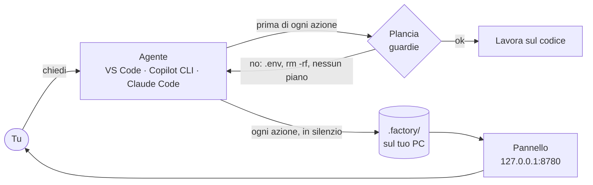
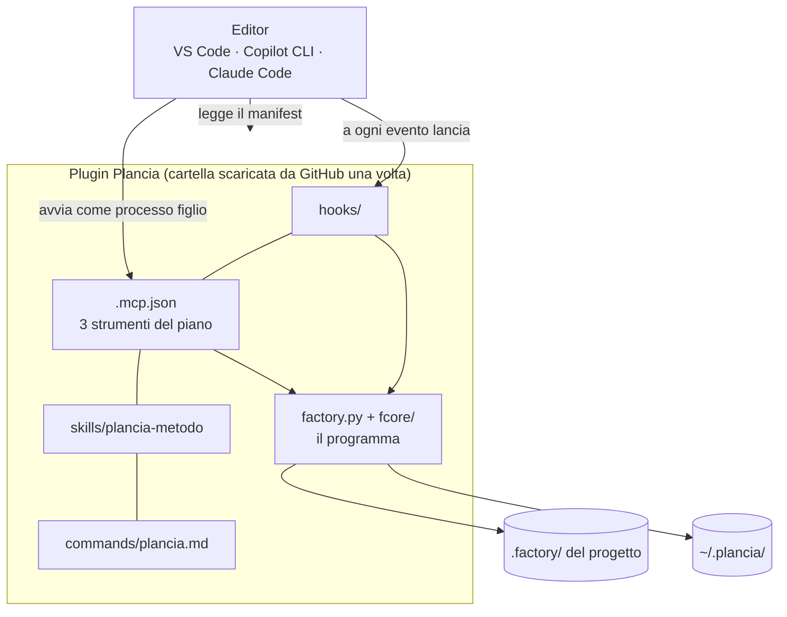
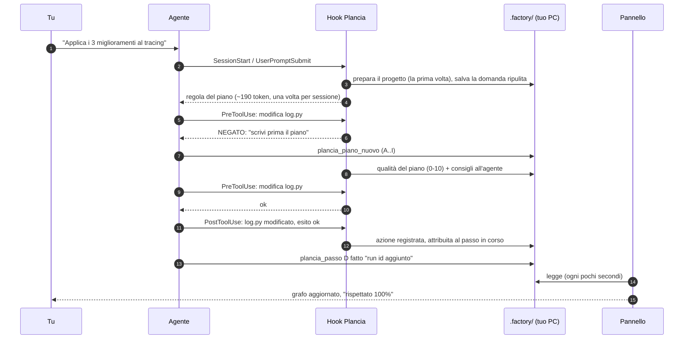
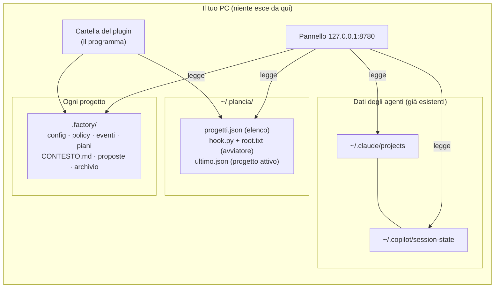

# Plancia: come funziona

Questo documento ha due parti.
**Parte 1 (5 minuti, per tutti)**: cos'è, cosa risolve, cosa garantisce.
**Parte 2 (per chi sviluppa)**: come è fatta dentro, da dove prende le informazioni, dove le salva, come si estende.
In fondo: le domande che arrivano sempre, con la risposta breve.

---

## Parte 1 · In breve

### Il problema
Gli agenti di codice (Copilot nella chat di VS Code, Copilot CLI, Claude Code) lavorano bene, ma:
- **non si vede cosa stanno facendo**: con 4-5 progetti aperti non sai chi ha finito, chi aspetta te, chi è bloccato o gira in tondo;
- **non dichiarano un piano**: partono a modificare file e capisci solo alla fine cosa hanno toccato;
- **possono fare danni**: leggere o cambiare un `.env`, lanciare un `git push --force`, cancellare dati;
- **consumano senza che tu lo veda**: quanti token, su quale progetto.

### Cosa fa la Plancia
| | |
|---|---|
| **Vedere** | Una pagina nel browser con tutti i progetti: stato di ogni agente, ultima richiesta, piano, consumo. |
| **Pianificare** | Prima di modificare file l'agente deve scrivere un piano a passi. La Plancia lo disegna come grafo e mostra, passo per passo, cosa ha fatto davvero. |
| **Proteggere** | Blocca prima che accada: file protetti, comandi pericolosi, modifiche senza piano. |
| **Migliorare** | Propone skill utili per ogni progetto (es. "comandi di build e test sempre pronti") e misura la qualità dei piani. |

### Cosa garantisce
- **Tutto resta sul tuo PC.** Nessun server esterno, nessuna telemetria, nessun account. Il pannello risponde solo su `127.0.0.1`.
- **Non tocca il codice dei progetti.** Con il plugin non scrive nulla nel repository: solo una cartella `.factory/` esclusa da git sul tuo PC.
- **Zero token per guardare.** Il pannello legge file locali; all'agente costa solo una regola di ~190 token a inizio sessione.
- **Non blocca mai il lavoro per un suo errore.** Se la Plancia ha un problema, l'agente continua come se non ci fosse (le guardie invece bloccano, per scelta).
- **Nessuna dipendenza.** Solo Python standard: niente da installare, niente da aggiornare a parte la Plancia stessa.

---

## Parte 2 · Come è fatta

### I pezzi
| Pezzo | Cos'è | Chi lo avvia | Costa token? |
|---|---|---|---|
| **Hook** | Piccoli comandi che l'editor lancia a ogni evento (domanda, prima/dopo uno strumento, fine). Registrano e fanno da guardia. | L'editor, automaticamente | No |
| **Strumenti del piano (MCP)** | 3 strumenti: `plancia_piano_nuovo`, `plancia_passo`, `plancia_piano_aggiungi`. L'agente li usa per scrivere e aggiornare il piano. | L'editor, come processo figlio locale | Pochi (descrizioni brevi) |
| **Skill `plancia-metodo`** | Il metodo di lavoro: piano prima, soluzione minima, niente giri a vuoto, verifica, esito a semaforo. | L'agente la legge quando serve | Solo la riga di descrizione, finché non serve |
| **Pannello** | Un piccolo server web locale in sola lettura, più una pagina HTML. | Si accende da solo al primo uso | No |
| **CLI** | `factory.py`: gli stessi comandi da terminale (`piano`, `passo`, `strumenti`, `diagnosi`...). | Tu o l'agente | No |

Tutto è Python standard in un'unica cartella (`factory.py`, `fcore/`, `skills/`).

### "Ma non era un MCP locale?"
Sì, e lo è ancora. **MCP** (Model Context Protocol) qui non è un servizio in rete: è un **processo locale** che l'editor avvia e con cui parla via *stdin/stdout* (JSON-RPC). Nessuna porta aperta, nessuna connessione.
L'MCP però copre solo una parte (gli strumenti per scrivere il piano). Per **vedere** e **proteggere** servono gli **hook**, che l'editor chiama a ogni evento. Il **plugin** è solo il "pacchetto" che consegna all'editor tutti i pezzi insieme: hook + MCP + skill + comando `/plancia`.

### Come è diventata un plugin
Un repository GitHub può essere installato come **plugin** dai tre ambienti, che leggono un *manifest*:

| Ambiente | Manifest letto | Come trova la Plancia |
|---|---|---|
| Claude Code (e VS Code in formato Claude) | `.claude-plugin/plugin.json` | variabile `${CLAUDE_PLUGIN_ROOT}` |
| Copilot CLI e chat di VS Code | `.github/plugin/plugin.json` | un piccolo avviatore fisso in `~/.plancia/hook.py` |

Perché l'avviatore? Gli hook in formato Copilot non hanno una variabile documentata per "dove sta il plugin". Allora, al primo avvio, la Plancia scrive in `~/.plancia/` due file:
- `root.txt`: dove sta la cartella del plugin;
- `hook.py`: un avviatore di poche righe che legge `root.txt` (o cerca nelle cartelle note) e passa l'evento al programma.

Gli hook chiamano sempre `~/.plancia/hook.py`, anche dopo un aggiornamento: per questo gli aggiornamenti non rompono niente.

### Cosa succede quando lavori

### Da dove prende le informazioni
| Fonte | Cosa contiene | Come la legge |
|---|---|---|
| Conversazioni di **Claude Code** `~/.claude/projects/*/*.jsonl` | domande, risposte, strumenti usati, token | lettura del file, nessun LLM |
| Sessioni di **Copilot CLI** `~/.copilot/session-state/*/events.jsonl` | lo stesso | lettura del file |
| **Chat di VS Code** | non scrive conversazioni leggibili: tutto arriva dagli **hook** | `.factory/eventi.jsonl` |
| **Piani** `.factory/piani/*.json` | passi, dipendenze, stato, risultati | scritti dall'agente tramite MCP o CLI |
| **Mappa del progetto** `.factory/CONTESTO.md` | linguaggi, moduli, comandi di build e test (anche Maven/JDK fuori dal PATH), test, file grandi | scansione dei file, nessun LLM |

Da queste fonti la Plancia ricostruisce le **richieste** (domanda → azioni → fine), lo **stato** di ogni agente (lavora, ha finito, aspetta un permesso, errori ripetuti, in loop, fermo) e il **consumo**.
Riconosce anche i **sotto-agenti**: i loro messaggi non diventano richieste nuove, sono rami della tua.

### Come tiene traccia del piano
- **Piano obbligatorio**: la guardia nega le modifiche finché non c'è un piano più recente dell'ultima domanda.
- **Attribuzione**: ogni azione registrata finisce nel passo "in corso" in quel momento. Se l'agente si dimentica di segnare l'inizio di un passo, le azioni precedenti vengono attribuite a ritroso.
- **Qualità del piano (0-10)**: controllo deterministico al momento della scrittura. Penalizza passi vaghi, senza oggetto, segnaposto, assenza di baseline o di verifica, catene uniche quando la richiesta chiede rami paralleli. All'agente arrivano subito i consigli e i comandi veri del progetto.
- **Rispettato %**: a richiesta finita conta i passi chiusi senza nessuna azione, quelli lasciati aperti, le modifiche fuori piano e i passi chiusi senza risultato.

### Come gestisce le skill
- **Inventario** (scheda Strumenti): skill del progetto (`.claude/skills`, `.github/skills`), skill per tutti i progetti (`~/.claude/skills`, `~/.copilot/skills`), skill dei plugin; più server MCP, istruzioni fisse con il loro costo in token, hook e plugin.
- **Proposte**: nascono da fatti visti nel progetto, ad esempio comandi di build già noti, un progetto Java senza una guida ai test, skill doppie o istruzioni fisse troppo lunghe. Per ogni proposta:
  - **Sì**: la Plancia la crea da sola, oppure prepara il testo da incollare in chat con le informazioni che già ha;
  - **No**: non viene più riproposta per quel progetto (`.factory/proposte.json`);
  - quando la skill esiste, la proposta sparisce.
- Le skill di progetto create dalla Plancia sono escluse da git **solo sul tuo PC** (`.git/info/exclude`).

### Dove sta ogni cosa

| Percorso | Contenuto | Va in git? |
|---|---|---|
| `<progetto>/.factory/` | eventi, piani, mappa, guardie, proposte, archivio | **No**: `.factory/.gitignore` con `*`, più `.git/info/exclude` |
| `~/.plancia/` | elenco progetti, avviatore degli hook | non è in nessun repository |
| cartella del plugin | il programma (sola lettura) | è il repository della Plancia |

### Sicurezza (in dettaglio: [SECURITY.md](../SECURITY.md))
- **Rete**: il pannello ascolta solo su `127.0.0.1`. Rifiuta richieste con un `Host` estraneo (protezione dal *DNS rebinding*) e scritture da altri siti (controllo `Origin`). Manda le intestazioni `Content-Security-Policy`, `X-Frame-Options: DENY` e `nosniff`. Per esporlo in rete servono `--host` e `--token` espliciti.
- **Unica scrittura dal pannello**: accetta o rifiuta una proposta (`POST` JSON, stessa origine, progetto registrato, id validato).
- **Segreti**: gli hook salvano il **tipo** di azione e l'oggetto (file o comando accorciato), mai il contenuto. Domande e risposte vengono accorciate e ripulite da password, token, chiavi API e stringhe di connessione prima di essere scritte.
- **Guardie predefinite**:
  - file protetti: `.env*`, `*.pem`, `*.key`, `id_rsa*`, `secrets/`, `credentials*`, `.git/`;
  - comandi vietati: `rm -rf` su radici, `git push --force`, `git reset --hard`, `DROP/TRUNCATE`, `DELETE` senza `WHERE`, `mkfs`, `dd`, `curl … | sh`.

  Si estendono per progetto in `.factory/policy.json`.
- **Codice**: niente `shell=True`, `eval`, `exec` o `pickle`; i sottoprocessi usano liste di argomenti. A ogni push GitHub esegue test (Windows e Linux, Python 3.9 e 3.13), `ruff` (qualità e regole di sicurezza) e `bandit`.
- **Limite dichiarato**: le guardie fermano gli errori dell'agente, non sostituiscono i permessi veri (utenti DB in sola lettura, branch protetti).

### Costi
| Cosa | Token |
|---|---|
| Guardare il pannello | 0 |
| Regola del piano all'agente | ~190 una volta per sessione |
| Skill del metodo | solo la descrizione finché non serve, poi ~1.600 |
| Strumenti del piano (MCP) | descrizioni brevi, come qualsiasi strumento |
| Mappa del progetto | 0 (generata senza LLM) e **fa risparmiare**: l'agente non esplora per capire il progetto |

---

## Domande che arrivano sempre
**Devo aggiungere i progetti a mano o scrivere file di configurazione?**
No. Con il plugin un progetto si prepara da solo alla prima domanda. L'installazione classica (`Installa-in-un-progetto` o `factory.py init --scrivi`) esiste per chi vuole la configurazione nel repository, condivisa con il team.

**Funziona con Copilot, con Claude o con tutti e due?**
Con tutti: chat di VS Code, Copilot CLI, Claude Code. Stesso pannello, stessi piani.

**Manda dati da qualche parte? A GitHub, a Microsoft, ad Anthropic?**
No. La Plancia non fa chiamate di rete. Gli agenti continuano a parlare con i loro servizi come sempre: la Plancia non cambia questo e non aggiunge nulla.

**Rallenta l'agente?**
Ogni hook dura una frazione di secondo. La scansione del progetto avviene una volta, all'inizio.

**Se la Plancia si rompe, si blocca anche l'agente?**
No. Ogni errore interno viene ignorato e l'agente continua. Solo le guardie, per scelta, possono dire "no".

**Posso usarla su un repository di un cliente?**
Sì: con il plugin non entra nel repository e non lascia file da committare. I dati restano nella cartella `.factory/` sul PC di chi lavora.

**Come si aggiorna?**
`git pull` nella cartella del plugin, poi *Reload Window* (vedi README). Il pannello nuovo prende da solo il posto di quello vecchio.

**Come si toglie?**
Disinstalli il plugin. Se vuoi, cancelli le cartelle `.factory/` dei progetti e `~/.plancia/`: non resta altro.
